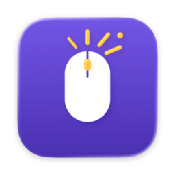

<p align="center">
  
</p>

<h1 align="center">MouseSmith</h1>

<p align="center">
  Haz que cualquier mouse se sienta en casa en tu Mac.<br>
  <i>Make any mouse feel at home on your Mac.</i>
</p>

---

## Español

MouseSmith es una app de barra de menú para mouse que no son de Apple:

- **Scroll suave** con cinco curvas, velocidad y duración, e **invertir sólo el mouse** sin tocar el trackpad.
- **Botones a tu medida:** atrás y adelante, copiar y pegar, Mission Control, botones 4 y 5, atajos propios o un atajo de la app Atajos, con **perfiles por app**.
- **Mouse que mandan atajos raros** (como la UGREEN MU008): sus botones se vuelven botones de verdad, sin afectar tu teclado. Con **Aprender botones** para cualquier mouse.
- **Batería del mouse** en el panel y aviso cuando está baja.

**Estado:** beta. Este repositorio guarda las descargas y las actualizaciones; el código de la app es privado.

### Requisitos

- macOS 14 Sonoma o posterior (con Liquid Glass en macOS 26 o posterior).
- Mac con Apple Silicon (M1 o posterior).
- Permiso de Accesibilidad (la app lo pide la primera vez). MouseSmith nunca registra lo que escribes.

### Instalar

- **Descarga:** el `.dmg` más reciente en [Releases](https://github.com/Diegoafigue/MouseSmith-releases/releases). Ábrelo y arrastra MouseSmith a Aplicaciones.
- **Homebrew:**

  ```bash
  brew install --cask diegoafigue/tap/mousesmith
  ```

### Actualizaciones

La app avisa sola cuando hay una versión nueva; también puedes buscarla con clic derecho en su ícono › **Buscar actualizaciones…**. Si la instalaste con Homebrew, también funciona `brew upgrade --cask --greedy mousesmith`.

### Comentarios y errores

Abre un [issue](https://github.com/Diegoafigue/MouseSmith-releases/issues) con la marca y el modelo de tu mouse, cómo está conectado (Bluetooth, USB o receptor) y tu versión de macOS.

---

## English

MouseSmith is a menu bar app for mice that aren't made by Apple:

- **Smooth scrolling** with five curves, speed and duration, and **reverse the mouse only** without touching the trackpad.
- **Buttons your way:** back and forward, copy and paste, Mission Control, buttons 4 and 5, your own shortcuts or one from the Shortcuts app, with **app profiles**.
- **Mice that send odd shortcuts** (like the UGREEN MU008): their buttons become real buttons, without affecting your keyboard. With **Learn Buttons** for any mouse.
- **Mouse battery** in the panel, with a warning when it runs low.

**Status:** beta. This repository holds the downloads and updates; the app's source code is private.

### Requirements

- macOS 14 Sonoma or later (Liquid Glass on macOS 26 or later).
- A Mac with Apple Silicon (M1 or later).
- Accessibility permission (the app asks the first time). MouseSmith never records what you type.

### Install

- **Download:** the latest `.dmg` from [Releases](https://github.com/Diegoafigue/MouseSmith-releases/releases). Open it and drag MouseSmith to Applications.
- **Homebrew:**

  ```bash
  brew install --cask diegoafigue/tap/mousesmith
  ```

### Updates

The app tells you when a new version is out; you can also right-click its icon › **Check for Updates…**. If you installed it with Homebrew, `brew upgrade --cask --greedy mousesmith` works too.

### Feedback and bugs

Open an [issue](https://github.com/Diegoafigue/MouseSmith-releases/issues) with your mouse's brand and model, how it's connected (Bluetooth, USB or a receiver) and your macOS version.

---

MouseSmith © 2026 Diego Figueroa. Free to download and use; see [LICENSE](LICENSE).
